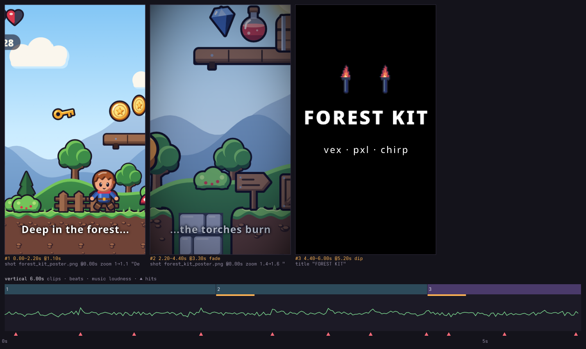
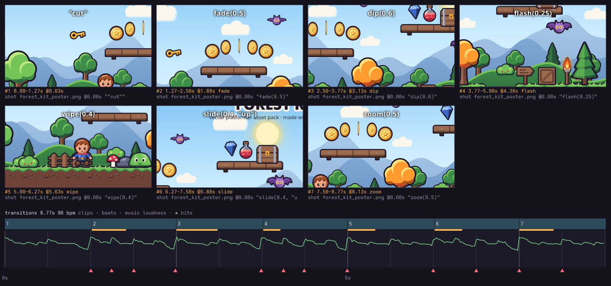

# reel

**Video game trailers as code.** Write a small `.rx.js` file of shots, title cards and transitions;
reel cuts them to the music's beat, moves a camera over every shot, mixes music and sfx, and renders
an MP4 with ffmpeg. A live viewer scrubs exact frames and plays a proxy with sound as you save.

Built for AI agents (it ships as a Claude Code skill). An agent can't watch a video, so every build
writes a **contact sheet** (a frame from every clip over a strip of clips × beats × music loudness ×
hits), and `reel info` prints **where every cut lands on the beat grid, how loud the music is under
each clip, its strongest hits and its tempo**: the agent edits by reading.

Part of a family with [**vex**](https://github.com/uilianks/vex) (vector art, skeletal animation),
[**pxl**](https://github.com/uilianks/pxl) (pixel art), [**chirp**](https://github.com/uilianks/chirp)
(game audio), [**kiln**](https://github.com/uilianks/kiln) (low-poly and voxel 3D) and
[**loom**](https://github.com/uilianks/loom) (seamless textures). Same architecture: sandboxed source
files, errors with exact locations, agent-readable previews, a live viewer and an annotate-and-send
feedback loop. reel is the last step: it turns what the others make into a trailer.

## Showcase: LAST CUP teaser

[](docs/media/last_cup.mp4)

▶ **[Watch the 35 s teaser with sound](docs/media/last_cup.mp4)** · [9:16 cutdown](docs/media/last_cup_vertical.mp4) ·
source: [`last_cup.rx.js`](showcase/last_cup.rx.js) · score: [`trailer_score.cx.js`](showcase/trailer_score.cx.js)

Cut from the family's own renders (kiln's 3D camera moves, vex's vector scene) to a score written
in chirp at 100 bpm: rain and pads, the pulse at bar 5 with two-beat cuts, a riser with a cut on
every beat pushing ever closer, a BRAAM on the drop under the title, and the end card on the final
hit. Every cut lands on a beat; the 9:16 version reuses the score and re-aims every shot.

The contact sheet the agent reads instead of watching:


## The language

```js
trailer("teaser", { w: 1920, h: 1080, fps: 30, bpm: 100, music: "score.wav", letterbox: 2.39, fadeIn: 1 },
  shot("establish.mp4", { beats: 8, move: { zoom: [1, 1.08] } }),
  title("THE RAIN NEVER STOPS", { beats: 4, tracking: 0.18, in: fade(0.3) }),
  shot("hero.mp4", { beats: 2, from: 3.5, move: { zoom: [1.1, 1.25], x: 0.6 }, in: flash(0.15), sfx: "whoosh.wav" }),
  shot("idle.gif", { beats: 2, pixel: true, fit: "contain" }),
  [1, 4, 8, 6].map((from, i) => shot("fight.mp4", { beats: 1, from, move: { zoom: 1.1 + i * 0.08 } })),
  title("LAST CUP", { beats: 4, size: 150, anim: "punch" }),
  title("LAST CUP", { beats: 6, sub: "WISHLIST NOW · 2027", in: flash(0.3) }))
```

Shots (video, GIF, image) with `from`, `speed`, `fit`, `move` (zoom and a focus point that stays in
frame), `caption`, their own `audio`; titles with `push`/`punch` animation, wrapping, tracking and
subtitles; `fade dip flash wipe slide zoom` transitions; `overlay` images, GIFs and videos on any clip
(logos, sprites, picture-in-picture); `grade` looks (brightness, contrast, saturation, gamma, tint,
vignette) per clip or for the whole trailer; `sfx` on any clip; letterbox and fades; several trailers
per file; `--gif` for an animated GIF. Full API: [reference.md](reference.md). Agent guide: [SKILL.md](SKILL.md).

## Examples

Rendered by `npm run examples` from the files in [`examples/`](examples). The footage is the art-tool
family's own output (pxl scenes, a vex poster, chirp music), copied into
[`examples/media/`](examples/media) with where each file came from.

**A teaser cut on the beat** ([`examples/teaser.rx.js`](examples/teaser.rx.js)): 96 bpm chirp theme,
camera moves over pixel-art scenes, title cards, `dip` / `flash` / `slide` / `wipe` transitions.

```js
// A 10 s teaser cut on the beat of a chirp theme (96 bpm): pixel-art scenes from pxl, a vex poster,
// title cards, camera moves and transitions. Build: reel build examples/teaser.rx.js --gif 480
trailer("teaser", { w: 640, h: 360, fps: 30, bpm: 96, music: { src: "media/theme.ogg", fadeOut: 1 }, letterbox: 2, fadeIn: 0.5 },
  shot("media/no_magic_night.gif", { beats: 4, pixel: true, move: { zoom: [1, 1.25], y: [0.55, 0.7] } }),
  title("SOMETHING IS BREWING", { beats: 2, size: 34, tracking: 0.16, in: dip(0.3) }),
  shot("media/cave.gif", { beats: 2, pixel: true, move: { zoom: [1.1, 1.3], x: [0.3, 0.6] }, in: flash(0.2) }),
  shot("media/forest_kit_poster.png", { beats: 2, move: { zoom: [1.3, 1.1], x: 0.4 }, in: slide(0.3, "right") }),
  shot("media/forest_kit_anims.gif", { beats: 2, fit: "contain", bg: "#1d2b3a", in: wipe(0.3) }),
  title("NO MAGIC", { beats: 4, size: 72, sub: "A REEL EXAMPLE", anim: "punch", in: flash(0.25) }))
```

[](docs/examples/teaser.mp4)

▶ [MP4 with sound](docs/examples/teaser.mp4) · [contact sheet](docs/examples/teaser_sheet.png)

**A 9:16 short** ([`examples/vertical.rx.js`](examples/vertical.rx.js)): one wide poster re-aimed by
`move`, captions, a night `grade`, pixel torches as `overlay`s on the end card, a cave ambience.

```js
// A 9:16 short for phones: one wide poster re-aimed by camera moves, captions, a night grade, pixel
// torches as overlays on the end card, and a cave ambience under it all.
// Build: reel build examples/vertical.rx.js --gif 240
const poster = "media/forest_kit_poster.png"
const torch = (x) => ({ src: "media/torch.gif", x, y: 0.3, h: 0.13, pixel: true })
trailer("vertical", { w: 360, h: 640, fps: 30, music: { src: "media/cave.ogg", fadeOut: 0.8 }, fadeIn: 0.4, fadeOut: 0.4 },
  shot(poster, { dur: 2.2, move: { zoom: [1, 1.1], x: [0.15, 0.35] }, caption: { text: "Deep in the forest...", size: 26 } }),
  shot(poster, { dur: 2.2, move: { zoom: [1.4, 1.6], x: [0.6, 0.8], y: 0.6 }, in: fade(0.4),
    caption: { text: "...the torches burn", size: 26 },
    grade: { brightness: -0.08, saturation: 0.8, tint: "#3050a0", tintAmount: 0.2, vignette: 0.6 } }),
  title("FOREST KIT", { dur: 1.6, size: 48, sub: "vex · pxl · chirp", in: dip(0.4), overlay: [torch(0.36), torch(0.64)] }))
```

[](docs/examples/vertical.mp4)

▶ [MP4 with sound](docs/examples/vertical.mp4)

**Every transition** ([`examples/transitions.rx.js`](examples/transitions.rx.js)): one clip per
transition, each captioned with the call that made it; plain JS builds the clips.

```js
// Every transition, one per beat-pair, each labelled with its own call. One still re-framed per clip
// (move keeps a chosen point centred), so the transitions are easy to read.
// Build: reel build examples/transitions.rx.js --gif 480
const still = "media/forest_kit_poster.png"
const look = (x, y, call, transition) =>
  shot(still, { beats: 2, move: { zoom: 2.2, x, y }, in: transition, caption: { text: call, size: 30, pos: "top" } })
trailer("transitions", { w: 640, h: 360, fps: 30, bpm: 96, music: { src: "media/theme.ogg", fadeOut: 0.6 } },
  look(0.2, 0.5, '"cut"', "cut"),
  look(0.4, 0.4, "fade(0.5)", fade(0.5)),
  look(0.6, 0.5, "dip(0.6)", dip(0.6)),
  look(0.8, 0.6, "flash(0.25)", flash(0.25)),
  look(0.3, 0.7, "wipe(0.4)", wipe(0.4)),
  look(0.7, 0.3, 'slide(0.4, "up")', slide(0.4, "up")),
  look(0.5, 0.5, "zoom(0.5)", zoom(0.5)))
```

[](docs/examples/transitions.mp4)

▶ [MP4 with sound](docs/examples/transitions.mp4)

## Commands

```bash
reel build trailer.rx.js            # out/<name>.mp4 + out/_preview/<name>.png
reel build trailer.rx.js --proxy    # half size, drawn in cached chunks on every free core
reel info  trailer.rx.js            # cuts vs beats, music under each clip, warnings
reel frame trailer.rx.js teaser 12.4
reel serve trailer.rx.js            # live viewer on http://127.0.0.1:4340
```

The viewer shows the timeline with beats, loudness and hits; click to scrub exact frames, space to
play the proxy with sound, `,`/`.` to jump between cuts, `n` (or shift-drag) to pin notes and send
them to the agent as `out/_feedback/<name>.json` with the clip, its source line and the frame.

## How it works

The timeline is resolved once, frame-exact (beat lengths snap the cut, not the length, so cuts never
drift). One compositor draws every frame (shots placed by fit/zoom/focus, transitions, titles,
captions, letterbox, fades); the viewer, the contact sheet, `frame` and the final render all go
through it, so what the agent inspects is what gets encoded. Renders stream each shot through one
ffmpeg decoder at the output frame rate, compose in JS, pipe raw frames to x264, and mix the audio
in the same ffmpeg run. A 35 s 1080p30 trailer renders in about 50 s on a desktop CPU.

The proxy (the live viewer's preview, `build --proxy`) is drawn in 45-frame chunks, one process per free core, each cached by a hash of what goes into its frames (the clips that touch it, the trailer's look, the sources' size and time); an edit redraws only the chunks it touched, then the chunks are joined without re-encoding and the sound is mixed once. A 59 s 1080p trailer: ~24 s cold, ~1 s unchanged, ~5 s after one caption edit (it was ~105 s each time).

Needs Node ≥ 22.18 and ffmpeg. Text uses system fonts through fontconfig and resvg. A render is
written to `<name>.part.mp4` and renamed when it completes, so a failed or cancelled render never
leaves a truncated MP4 under the real name.

`npm run check` typechecks, runs the tests and renders every example (`npm run examples`, which also
refreshes `docs/examples/`).

## License

MIT
